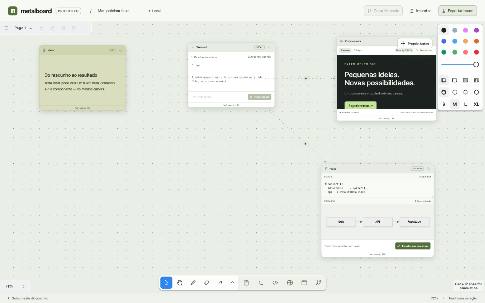
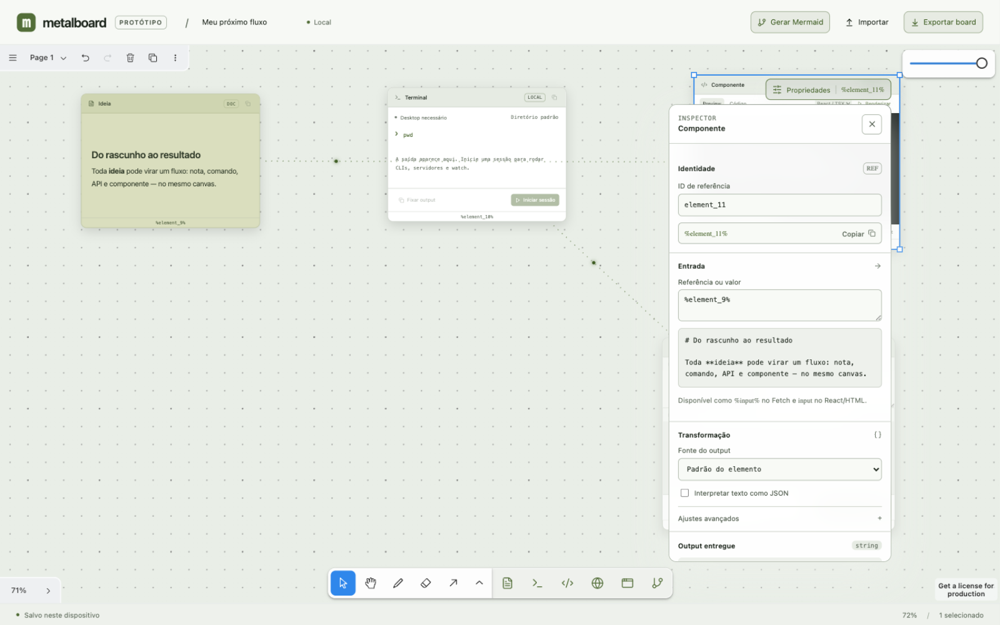
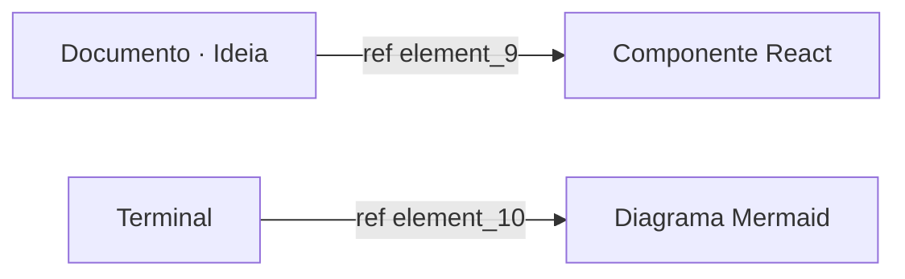
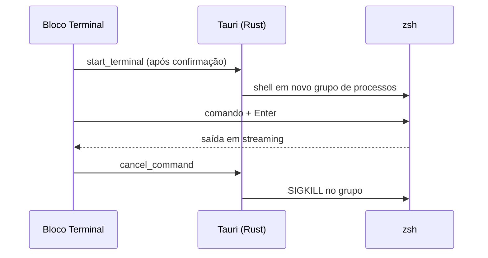
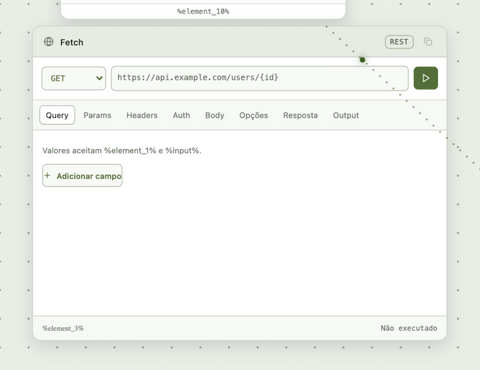
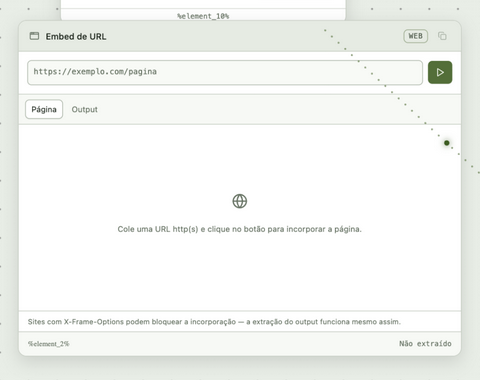
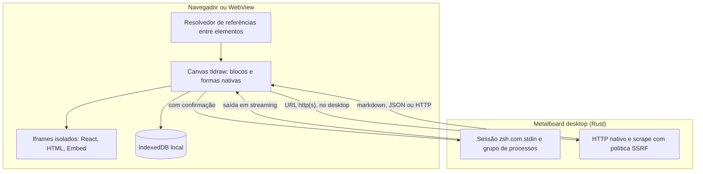

# Metalboard

Protótipo desktop de canvas infinito com tldraw, React e Tauri: notas, terminais, componentes, requisições HTTP, páginas da web e diagramas no mesmo board — conectados por referências de dados.



Requer Node 22+, Rust e ferramentas de desenvolvimento macOS.

```sh
npm install
npm run dev       # canvas no navegador em http://localhost:1420 (execução local desativada)
npm run desktop   # app desktop com execução real de comandos, HTTP nativo e menus
npm run build     # verificação TypeScript e build web
```

Para iniciar `npm run desktop`, encerre primeiro qualquer `npm run dev` já usando a porta 1420; o Tauri inicia seu próprio servidor.

## O que há no canvas

A barra de ferramentas do tldraw inclui o grupo **Ferramentas Metalboard**: Documento, Terminal, Componente, Fetch, Embed e Mermaid. Além deles, as formas nativas do tldraw (texto, notas, setas, formas geométricas) participam do board e das exportações. Arraste os blocos pelo cabeçalho; duplo clique no título renomeia.

| Bloco | O que faz |
| --- | --- |
| **Documento** | Editor WYSIWYG de markdown (Milkdown) com títulos, negrito, listas e referências `%id%` resolvidas |
| **Terminal** | Sessão de shell zsh persistente no computador, com stdin aberto e saída em streaming |
| **Componente** | React/TSX ou HTML renderizado em iframe isolado, empacotado localmente com Babel |
| **Fetch** | Requisições REST com query, params, headers, auth e body; resposta com status, duração e headers |
| **Embed** | Incorpora uma página em iframe e extrai o conteúdo como Markdown ou relatório JSON |
| **Mermaid** | Fonte Mermaid com preview sincronizado; converte o diagrama em formas editáveis no board |
| **Output** | Snapshot somente leitura de uma saída fixada (terminal, fetch ou embed) |

## Fluxo de dados entre elementos

Qualquer elemento pode consumir o output de outro com uma referência `%id%` — digitada no conteúdo, na entrada do bloco ou montada no inspetor **Propriedades** (canto superior direito). O board desenha setas pontilhadas animadas mostrando cada dependência, e o resolvedor detecta referências circulares (limite de 40 encadeamentos).

No inspetor cada elemento expõe identidade (`%id%`), entrada e transformação de output: interpretar como JSON, selecionar um caminho (`users[0].name`), mapear cada item de um array e aplicar um template final. O resultado é entregue como `string`, número, objeto ou array para o elemento consumidor.





Um documento com `%element_10%` mostra o conteúdo resolvido quando fora de foco e a fonte crua durante a edição; um Fetch pode montar a URL com `%input%` e o body JSON aceita `%id%` preservando o tipo do valor substituído.

## Terminal com sessão persistente

No desktop, o terminal inicia uma sessão de shell após confirmação explícita (comando e diretório são mostrados antes de executar). A sessão mantém stdin aberto: dá para iniciar CLIs, servidores e watch, enviar comandos subsequentes com Enter e interromper tudo com um clique — o encerramento mata o grupo de processos. A saída em streaming é limitada aos últimos 100 mil caracteres; **Fixar output** cria um snapshot no canvas que outros elementos podem referenciar.



No navegador o bloco indica “Desktop necessário”: a execução local exige o app desktop.

## API e páginas da web



O **Fetch** cobre GET, POST, PUT, PATCH, DELETE, HEAD e OPTIONS com pares de query/params/headers (valores aceitam referências), autenticação Bearer, Basic ou API Key, body JSON, texto ou form e timeout configurável. A requisição usa o transporte nativo do desktop — sem restrição de CORS. O corpo da resposta tem limite de 2 MB e redirecionamentos automáticos ficam desativados. Credenciais de autenticação ficam apenas na sessão: nunca são salvas no board nem exportadas.

O **Embed** incorpora a página em um iframe (`sandbox`, sem cookies) e, na aba Output, extrai o HTML como Markdown da página ou relatório JSON (metadados, headings, links e texto visível). Sites com `X-Frame-Options` podem bloquear a incorporação — a extração funciona mesmo assim.



Ambos executam rede apenas no app desktop, pela mesma política SSRF do backend nativo: apenas HTTP/HTTPS, com resolução de DNS e endereços privados, loopback e reservados rejeitados no destino final. No navegador o iframe do Embed continua funcionando, mas os botões de envio e extração ficam desativados.

## Diagramas Mermaid

O bloco Mermaid renderiza a fonte com preview sincronizado (tema claro/escuro) e aponta erros de sintaxe. **Transformar no canvas** cria formas tldraw editáveis a partir do diagrama. No sentido inverso, o botão **Gerar Mermaid** da barra superior converte a seleção atual — caixas, notas, blocos e as setas que os ligam — em um novo bloco Mermaid com o diagrama do fluxo.

## Previews isolados

Componentes React (declare `function App()`, use `React.useState` etc.), HTML e TSX são empacotados localmente e renderizados em iframe sem same-origin, com CSP que bloqueia rede e sem acesso a APIs do Tauri. Código com loops infinitos ainda pode travar a WebView: o preview é para código próprio, não hospedagem de código hostil.

## Dados do board

Tudo fica no IndexedDB da origem/dispositivo — o rodapé mostra “Salvo neste dispositivo”. **Exportar board** gera JSON versionado (`format: metalboard, version: 1`); **Importar** substitui o board atual após confirmação e mantém uma cópia temporária com botão *Desfazer importação*. Apenas outputs fixados persistem; sessões de terminal não são restauradas ao reabrir.

## Arquitetura



| Diretório | Conteúdo |
| --- | --- |
| `src/shapes.tsx` | `BlockUtil`: os sete tipos de bloco e seus editores |
| `src/dataflow/` | Núcleo puro de referências, grafo de dependências, fetch e scrape + overlay de setas |
| `src/DataPanel.tsx` | Inspetor Propriedades (identidade, entrada, transformação, output) |
| `src/MarkdownDoc.tsx` | Editor de documentos Milkdown |
| `src/mermaid-canvas.ts`, `src/mermaid-export.ts` | Conversão seleção ↔ Mermaid |
| `src/runtime.ts` | Ponte com o Tauri (sessões de terminal, disponibilidade desktop) |
| `src-tauri/src/` | Shell nativo, `http_fetch` e `scrape_page` com política SSRF |
| `tests/` | Suíte Node (`node --test`) |

## Desenvolvimento

```sh
npm test                                          # 47 testes web (dataflow, edges, mermaid, preview, scrape)
cargo test --manifest-path src-tauri/Cargo.toml   # 9 testes nativos (shell e SSRF)
```

Licença tldraw necessária para distribuição de produção conforme os termos do SDK: configure `VITE_TLDRAW_LICENSE_KEY` quando aplicável.

## Limites deste protótipo

- macOS, sem instalador assinado.
- A sessão de terminal usa pipes com stdin aberto — não é um PTY real; CLIs que exigem TTY completo (senhas, alguns prompts interativos) podem não funcionar. stdout e stderr chegam mesclados.
- Fetch e Embed executam apenas no desktop: a política SSRF resolve DNS no destino final, o que só o transporte nativo faz.
- Sem conta, sincronização em nuvem, colaboração ou telemetria própria.
- Sessões de terminal não são restauradas ao reabrir o app; outputs não fixados somem.
- Migrações de futuras versões do formato podem exigir reimportação manual.

## Próximas etapas

O mapa em [docs/agentgrid-feature-map.md](docs/agentgrid-feature-map.md) registra a referência analisada e o caminho planejado: bloco de agente com provider/modelo, coordenador e workers especializados, follow-up e cancelamento por agente, integração Git com worktrees e diffs, busca de elementos e telemetria local de uso.

A copy de landing page em [docs/metalboard-landing-copy.md](docs/metalboard-landing-copy.md) deriva do protótipo atual e das imagens de direção visual.
